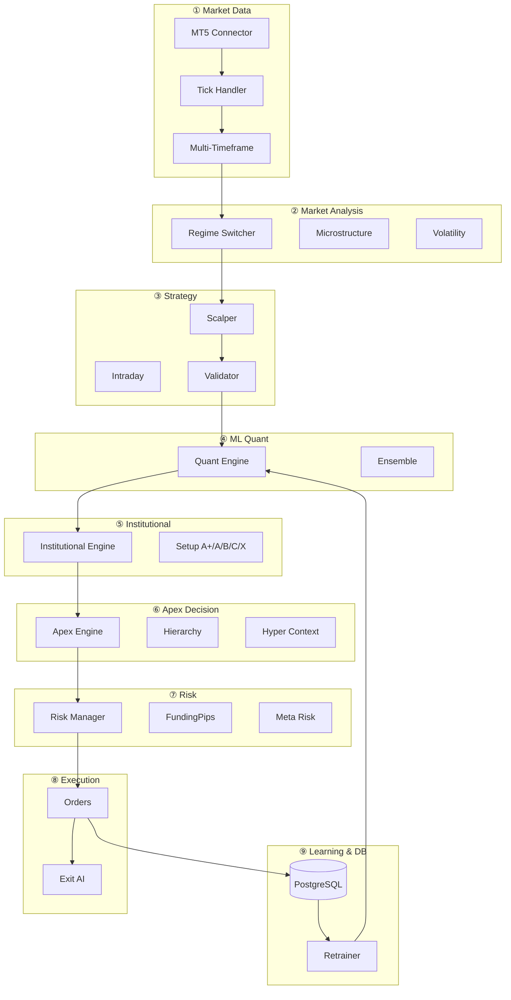
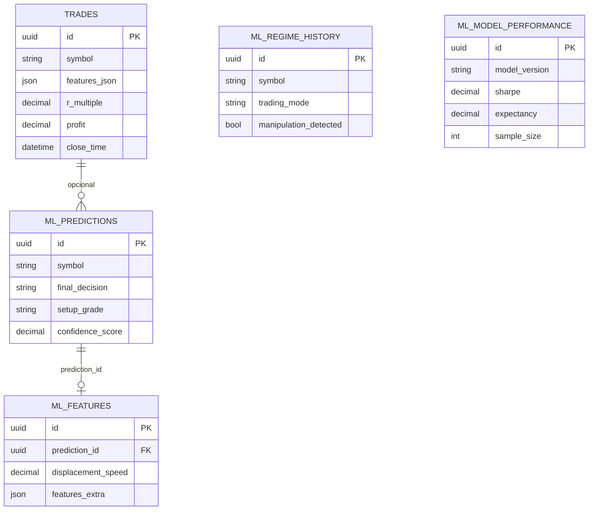
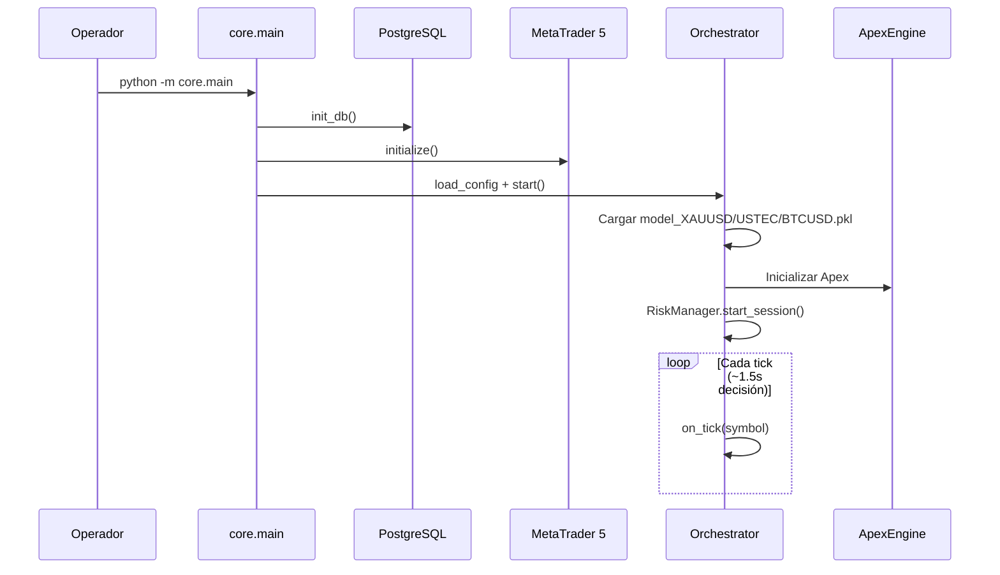
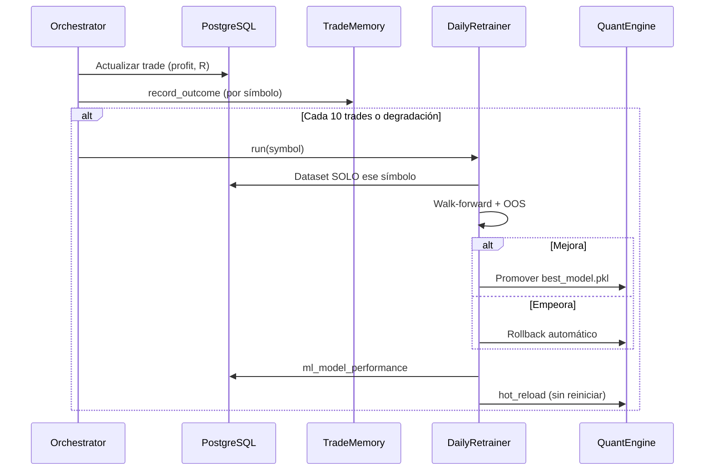

# AURION X 3.0 / APEX ENGINE
## Arquitectura completa del sistema cuantitativo institucional

**Versión:** 3.0 (Apex)  
**Audiencia:** Dirección, stakeholders, equipo técnico  
**Uso:** Exposición, onboarding, documentación de referencia  

---

## Tabla de contenidos

1. [Resumen ejecutivo](#1-resumen-ejecutivo)
2. [Concepto y filosofía](#2-concepto-y-filosofía)
3. [Stack tecnológico](#3-stack-tecnológico)
4. [Estructura del proyecto](#4-estructura-del-proyecto)
5. [Arquitectura en 9 capas](#5-arquitectura-en-9-capas)
6. [Base de datos PostgreSQL](#6-base-de-datos-postgresql)
7. [Machine Learning](#7-machine-learning)
8. [Jerarquía de decisión Apex](#8-jerarquía-de-decisión-apex)
9. [Secuencia operativa completa](#9-secuencia-operativa-completa)
10. [Auto-aprendizaje y retrain](#10-auto-aprendizaje-y-retrain)
11. [Gestión de riesgo y prop firm](#11-gestión-de-riesgo-y-prop-firm)
12. [Configuración y despliegue](#12-configuración-y-despliegue)
13. [Monitoreo y dashboard](#13-monitoreo-y-dashboard)
14. [Diferenciadores competitivos](#14-diferenciadores-competitivos)
15. [Comandos operativos](#15-comandos-operativos)
16. [Glosario](#16-glosario)

---

## 1. Resumen ejecutivo

**AURION X 3.0** es un sistema cuantitativo de trading algorítmico que opera en **MetaTrader 5**, aprende de sus propios resultados y entra al mercado solo cuando detecta **ventaja estadística + contexto institucional claro**.

No es un Expert Advisor tradicional basado en indicadores. Es un **motor modular** con:

| Capacidad | Descripción |
|-----------|-------------|
| Machine Learning | Ensemble por activo (RF, LR, XGBoost, LightGBM) |
| Análisis institucional | Sweeps, absorción, manipulación, liquidez |
| Microestructura | Velocidad, impulsos, agotamiento, spoofing |
| Jerarquía de decisión | 8 capas; si falla una superior → no opera |
| Base de datos | PostgreSQL para aprendizaje continuo |
| Prop firm | FundingPips, consistency, anti-overtrading |
| Auto-evolución | Retrain, versionado, rollback, hot-reload |

**Activos principales:** XAUUSD, USTEC, BTCUSD — cada uno con modelo, pesos y memoria independientes.

**Principio rector:**

> *Operar únicamente cuando existe ventaja estadística y contextual clara.*

**Prioridades:** precisión · consistencia · supervivencia · control de riesgo  
**Evita:** sobreoperación · grid agresivo · martingale · perseguir ruido

---

## 2. Concepto y filosofía

### 2.1 Problema que resuelve

| Bots retail típicos | AURION X 3.0 |
|---------------------|--------------|
| Indicadores aislados | Contexto total fusionado |
| Sin aprendizaje real | 1500+ trades en PostgreSQL con features |
| Mismo comportamiento siempre | Auto-retrain por símbolo y régimen |
| Sin protección funded | FundingPips + meta-riesgo + consistency |
| Optimizan winrate | Optimizan expectancy, sharpe, drawdown |

### 2.2 Enfoque institucional

**NO hace:**
- Comprar rupturas ciegas
- Perseguir velas sin contexto
- Operar en chop sin filtro
- Aumentar lotaje tras pérdidas (revenge)

**SÍ hace:**
- Detectar sweeps y stop hunts
- Medir absorción y intención real
- Identificar manipulación microestructural
- Adaptar agresividad al estado de la cuenta

### 2.3 Especialización por activo

| Activo | Foco principal | Pesos ML elevados |
|--------|----------------|-------------------|
| **XAUUSD** | Sweeps, absorción, reversión, sesiones | liquidity_sweep, absorption, manipulation |
| **USTEC** | Momentum, displacement, continuation | momentum, displacement, trend |
| **BTCUSD** | Fake breakouts, volatilidad extrema | volatility, fake_breakout, displacement |

---

## 3. Stack tecnológico

```
┌─────────────────────────────────────────────────────────┐
│  CAPA USUARIO / OPS                                      │
│  CLI · Dashboard · Logs · pgAdmin                        │
├─────────────────────────────────────────────────────────┤
│  PYTHON 3.11+                                            │
│  Orchestrator · Apex · ML · Risk · Strategy              │
├─────────────────────────────────────────────────────────┤
│  DATOS                                                   │
│  PostgreSQL 15 (Docker) · D:/AURION_DATA/              │
├─────────────────────────────────────────────────────────┤
│  BROKER                                                  │
│  MetaTrader 5 API                                        │
└─────────────────────────────────────────────────────────┘
```

| Componente | Tecnología |
|------------|------------|
| Runtime | Python 3.11+ |
| Broker | MetaTrader 5 |
| Base de datos | PostgreSQL 15 (Docker Compose) |
| ML | scikit-learn, XGBoost, LightGBM |
| Config | YAML + `.env` |
| Tests | pytest |
| Artefactos | `D:/AURION_DATA/models/`, `memory/`, `hints/` |

---

## 4. Estructura del proyecto

```
AURION_X_3_0/
├── core/                         # Núcleo operativo
│   ├── main.py                   # Entrada: python -m core.main
│   ├── orchestrator.py           # Pipeline tick → trade
│   └── train_model.py            # Entrenamiento manual
│
├── market/                       # Datos y análisis mercado
│   ├── tick_handler.py
│   ├── multi_timeframe.py
│   ├── microstructure_engine.py  # Apex
│   ├── market_regime_switcher.py
│   └── volatility_detector.py
│
├── strategy/                     # Señales
│   ├── scalper_engine.py
│   ├── intraday_engine.py
│   └── entry_validator.py
│
├── ml/                           # Inteligencia cuantitativa
│   ├── apex_engine.py            # Coordinador máximo
│   ├── institutional_engine.py
│   ├── quant_engine.py
│   ├── decision_hierarchy.py
│   ├── hyper_context_engine.py
│   ├── daily_retrainer.py
│   └── ...
│
├── execution/                    # Broker
│   ├── mt5_connector.py
│   ├── order_manager.py
│   └── execution_intelligence.py
│
├── risk/                         # Riesgo
│   ├── fundingpips_guard.py
│   ├── meta_risk_engine.py
│   └── anti_overtrading.py
│
├── analytics/                    # DB y métricas
│   ├── db_connection.py
│   ├── trade_repository.py
│   ├── quant_repository.py
│   └── dashboard_server.py
│
├── config/
│   └── parameters.yaml           # Configuración central
│
├── docs/
│   └── APEX_ARCHITECTURE.md      # Este documento
│
└── docker-compose.yml            # PostgreSQL + pgAdmin
```

---

## 5. Arquitectura en 9 capas

### Diagrama general



---

### Capa ① — Market Data Layer

| Módulo | Responsabilidad |
|--------|-----------------|
| `mt5_connector.py` | Conexión, autenticación, símbolos |
| `tick_handler.py` | Loop de ticks (polling) |
| `multi_timeframe.py` | OHLC M1 → MN1 |
| `session_filter.py` | Ventanas horarias |
| `volatility_detector.py` | LOW / NORMAL / HIGH / EXTREME |

---

### Capa ② — Market Analysis Layer

| Módulo | Responsabilidad |
|--------|-----------------|
| `market_regime_switcher.py` | trend · range · defensive · breakout |
| `range_trading_engine.py` | Calidad de rango, tradeable |
| `microstructure_engine.py` | Micro-features, manipulación |
| `range_quality.py` | Score de rango |
| `impulse_scan.py` | Impulsos H4 |

**Micro-features (Apex):**

| Feature | Significado |
|---------|-------------|
| micro_velocity | Velocidad del precio |
| tick_acceleration | Aceleración de ticks |
| impulse_decay | Decaimiento del impulso |
| absorption_pressure | Presión de absorción |
| directional_exhaustion | Agotamiento direccional |
| manipulation_score | Probabilidad manipulación |

---

### Capa ③ — Strategy Layer

| Motor | Uso |
|-------|-----|
| **ScalperEngine** | M1: pullback, continuación, range fade |
| **IntradayEngine** | Estructura M15+, reversiones |
| **EntryValidator** | Coherencia MTF, spread, score |

**Orden de prioridad en señales:**
1. Estructura fuerte → Intraday
2. Rango definido → Range reversion
3. Default → Scalper M1 (requiere ~25 velas warmup)

---

### Capa ④ — Machine Learning Layer

**Modelos:** RandomForest · LogisticRegression · XGBoost · LightGBM · Ensemble Voting

**Pipeline:**
```
Market State + Context
    → quant_features (25+ vars v2)
    → Ensemble predict (prob_buy / prob_sell)
    → probability_engine (continuation, reversal, sweep, absorption)
    → confidence_engine (score compuesto)
    → QuantDecision
```

**Rutas de modelos:**
```
D:/AURION_DATA/models/
├── model.pkl                 # Global legacy
├── model_XAUUSD.pkl          # Inferencia en vivo
├── model_USTEC.pkl
├── model_BTCUSD.pkl
├── XAUUSD/
│   ├── best_model.pkl        # Mejor OOS promovido
│   ├── rollback_model.pkl    # Fallback automático
│   └── versions/             # Historial
```

---

### Capa ⑤ — Institutional Layer

`InstitutionalEngine` envuelve `QuantMLEngine` y añade:

- Setup ranking (grades **A+, A, B, C, X**)
- Regime switching operativo
- Range trading gate
- FundingPips + Monte Carlo + Consistency
- Persistencia en tablas `ml_*`
- Trade Exit AI base

---

### Capa ⑥ — Apex Decision Layer

`ApexEngine` = Institutional + capas avanzadas:

| Componente | Función |
|------------|---------|
| `hyper_context_engine.py` | Fusión de todo el contexto |
| `latent_market_state.py` | Estados ocultos (HMM/clustering) |
| `decision_hierarchy.py` | Gates en orden estricto |
| `reinforcement_layer.py` | Policy por recompensa |
| `self_evolution_engine.py` | Evolución diaria |
| `meta_risk_engine.py` | aggressive / neutral / defensive |
| `anti_overtrading.py` | Anti-hiperactividad |

---

### Capa ⑦ — Risk Layer

| Módulo | Función |
|--------|---------|
| `risk_manager.py` | DD pause/stop, cooldown, kill-switch |
| `position_sizer.py` | Lotaje inteligente por grade + MC |
| `fundingpips_guard.py` | Límites prop firm adaptativos |
| `montecarlo.py` | Factor de lotaje por simulación |
| `consistency_engine.py` | Control profit diario |
| `meta_risk_engine.py` | Modo defensivo automático |
| `anti_overtrading.py` | Max trades/hora, spacing |
| `emergency_controller.py` | Spike ATR/spread |

---

### Capa ⑧ — Execution Layer

| Módulo | Función |
|--------|---------|
| `order_manager.py` | Open / close / partial / modify SL-TP |
| `execution_intelligence.py` | Spread decay, slippage, latency |
| `trade_exit_ai.py` | Partial close, anti-giveback |
| `dynamic_exit_manager.py` | BE, trailing (por activo) |

---

### Capa ⑨ — Learning & Analytics Layer

| Módulo | Función |
|--------|---------|
| `daily_retrainer.py` | Retrain por símbolo + OOS |
| `self_learning_engine.py` | Pesos adaptativos por activo |
| `trade_memory.py` | Memoria contextual con decay |
| `oos_validator.py` | Gate de promoción de modelos |
| `model_versioning.py` | best / rollback / versions |
| `dashboard_server.py` | Métricas HTTP :8765 |
| `equity_curve_ai.py` | Salud de equity |

---

## 6. Base de datos PostgreSQL

### 6.1 Infraestructura

```yaml
# docker-compose.yml
Servicio: postgres:15
Puerto:   5432
Base:     aurionx
Usuario:  aurion
UI:       pgAdmin → localhost:5050
```

**Arranque DB:**
```powershell
cd AURION_X_3_0
docker compose up -d
```

### 6.2 Tablas operativas

#### `trades` — Núcleo del aprendizaje

| Campo | Tipo | Uso |
|-------|------|-----|
| id | UUID | Identificador |
| symbol | string | XAUUSD, USTEC, BTCUSD |
| direction | LONG/SHORT | Lado |
| entry_price, exit_price | decimal | Precios |
| profit, r_multiple | decimal | Resultado |
| open_time, close_time | datetime | Temporal (walk-forward) |
| strategy | SCALPER/INTRADAY | Origen señal |
| ml_confidence | decimal | Confianza entrada |
| **features_json** | **JSON** | **Contexto completo al entrar (crítico ML)** |

#### `sessions` — Agregados diarios
total_trades, pnl, drawdown, winrate por fecha.

#### `system_states` — Snapshots cuenta
equity, balance, drawdown, timestamp.

---

### 6.3 Tablas cuantitativas (`ml_*`)

#### `ml_predictions`
Cada evaluación de entrada (ALLOW / BLOCK):

- confidence_score, ml_score, institutional_score, execution_score
- continuation / reversal / sweep / absorption probabilities
- final_decision, setup_grade, model_version
- extra (JSON: trading_mode, reasons)

#### `ml_features`
Features en columnas dedicadas + `features_extra` JSON:
displacement_speed, imbalance_strength, liquidity_density, sweep_rejection_speed, volatility_compression, directional_conviction, session_aggression, breakout_quality, absorption_strength, range_quality, trend_quality.

#### `ml_regime_history`
Por evaluación: market_regime, volatility_state, session_type, spread_state, manipulation_detected, sweep_density, trading_mode.

#### `ml_model_performance`
Por cada retrain promovido o rechazado:

| Métrica | Propósito |
|---------|-----------|
| accuracy, winrate | Calidad predictiva |
| sharpe, expectancy | Edge estadístico |
| drawdown, profit_factor | Supervivencia funded |
| stability_score, consistency_score | Anti-overfitting |
| sample_size, regime_label | Contexto entrenamiento |

---

### 6.4 Diagrama entidad-relación



---

## 7. Machine Learning

### 7.1 Features (schema v2)

Más de **25 variables cuantitativas**, incluyendo:

- displacement_speed, directional_conviction
- sweep_rejection, liquidity_density
- absorption_strength, breakout_quality
- volatility_compression, session_aggression
- range_quality, trend_quality
- microestructura (vía market_state)

### 7.2 Setup ranking

| Grade | Significado | Acción típica |
|-------|-------------|---------------|
| **A+** | Setup elite | Lotaje máximo permitido |
| **A** | Alta calidad | Operar normal |
| **B** | Aceptable | Lotaje reducido |
| **C** | Marginal | Solo si config permite |
| **X** | Basura | **Bloqueo automático** |

### 7.3 Estados latentes del mercado

`LatentMarketStateAI` detecta:

- alive · clean · accumulation · compression
- expansion · transition · manipulation · exhaustion · dangerous

---

## 8. Jerarquía de decisión Apex

**Orden estricto** — si falla una capa superior, **no hay trade**:

```
┌────────────────────────────────────────┐
│ 1. RIESGO          DD, límites cuenta  │
├────────────────────────────────────────┤
│ 2. ANTI-OVERTRADE  spacing, max/hora   │
├────────────────────────────────────────┤
│ 3. HYPER-CONTEXT   score fusionado     │
├────────────────────────────────────────┤
│ 4. RÉGIMEN LATENTE  estado peligroso   │
├────────────────────────────────────────┤
│ 5. MICROESTRUCTURA  manipulación        │
├────────────────────────────────────────┤
│ 6. ML CONFIDENCE   vs threshold         │
├────────────────────────────────────────┤
│ 7. SETUP RANKING   grade X = block      │
├────────────────────────────────────────┤
│ 8. EJECUCIÓN       spread, slippage     │
├────────────────────────────────────────┤
│ → ENTRADA                               │
└────────────────────────────────────────┘
```

Implementado en: `ml/decision_hierarchy.py`  
Coordinado por: `ml/apex_engine.py`

---

## 9. Secuencia operativa completa

### 9.1 Arranque



### 9.2 Pipeline por tick (entrada)

| Paso | Componente | Descripción |
|------|------------|-------------|
| 1 | TickHandler | Recibe tick MT5 |
| 2 | Warmup | ~25 velas M1 (~24 min al arrancar) |
| 3 | SessionFilter | ¿Horario operativo? |
| 4 | MultiTimeframe | Tendencias M1→MN1 |
| 5 | Emergency | Spike ATR/spread |
| 6 | RiskManager | DD, cooldown, kill-switch |
| 7 | Strategy | Scalper / Intraday / Range |
| 8 | Features | Vector ML v2 |
| 9 | ApexEngine | Micro + Latent + ML + Ranking + Hyper |
| 10 | DecisionHierarchy | Gates 1→8 |
| 11 | FundingPips | Límites prop firm |
| 12 | PositionSizer | Lotaje inteligente |
| 13 | EntryValidator | Validación final |
| 14 | OrderManager | Ejecución MT5 |
| 15 | PostgreSQL | Persist trade + ml_* |

### 9.3 Gestión de posiciones abiertas

En **cada tick** (aunque no haya entrada nueva):

1. Calcular R actual y max R
2. **TradeExitAI**: partial close, anti-giveback
3. **DynamicExitManager**: BE, trailing (si enabled)
4. Sync cierres con broker

### 9.4 Cierre → aprendizaje



---

## 10. Auto-aprendizaje y retrain

### Triggers de reentrenamiento

| Evento | Acción |
|--------|--------|
| Cada **10 trades** cerrados (por símbolo) | Retrain contextual |
| **22:00 UTC** diario | Retrain todos los activos activos |
| Degradación ML (WR bajo + R negativo) | Retrain + filtros más estrictos |
| Cambio de régimen | Recalibración pesos |

### Proceso (7 pasos)

1. Recopilar trades del símbolo (sin mezclar activos)
2. Walk-forward temporal (65% train · 15% val · test OOS)
3. Entrenar ensemble
4. Validar OOS: sharpe, expectancy, drawdown, overfitting
5. Promover solo si mejora vs `best_model.pkl`
6. Rollback automático si empeora
7. Hot-reload en vivo → log `[QUANT_RELOAD]`

### Memoria inteligente

Archivo: `D:/AURION_DATA/memory/trade_memory_<SYMBOL>.json`

- Buckets: setup + régimen + sesión + sweep
- Decay temporal (half-life 14 días)
- Olvido de setups degradados (WR < 35%)
- Insights: `historical_edge` / `historical_drag`

---

## 11. Gestión de riesgo y prop firm

### FundingPips Safe Mode

Controla:
- Drawdown diario y total
- Máximo trades por día/hora
- Racha de pérdidas (revenge guard)
- Grades mínimos (bloquea C/X)
- **Modo adaptativo:** endurece si DD sube; relaja si equity estable

### Meta Risk Engine

| Modo | Cuándo | Efecto |
|------|--------|--------|
| **Defensive** | DD alto, WR bajo | Lotaje ↓, threshold ↑ |
| **Neutral** | Normal | Parámetros base |
| **Aggressive** | WR alto, equity estable | Lotaje moderado ↑ |

### Monte Carlo

Simula distribución de R-multiples → `recommended_lot_factor` para position sizing.

---

## 12. Configuración y despliegue

### Archivo central

`config/parameters.yaml`

| Bloque | Controla |
|--------|----------|
| `symbols` | Activos operados |
| `ml` | Modelo global, veto, walk-forward |
| `quant_ml` | Ensemble, retrain, OOS validation |
| `institutional` | Ranking, FundingPips, MC |
| `apex` | Micro, latente, meta-riesgo, RL |
| `risk` | % riesgo, DD, kill-switch |
| `asset_profiles` | Spread, ml_model_path, pesos |

### Requisitos previos

1. MetaTrader 5 abierto y conectado
2. PostgreSQL activo (`docker compose up -d`)
3. Modelos en `D:/AURION_DATA/models/` (o bootstrap automático)
4. `.env` con credenciales si aplica

### Activación Apex

```yaml
# config/parameters.yaml
apex:
  enabled: true
institutional:
  enabled: true
quant_ml:
  enabled: true
```

---

## 13. Monitoreo y dashboard

### Dashboard cuantitativo

```powershell
aurion-dashboard
# Puerto: http://localhost:8765
```

### Logs clave

| Prefijo | Significado |
|---------|-------------|
| `[APEX]` | Motor Apex activo |
| `[QUANT_RELOAD]` | Modelo recargado en caliente |
| `[QUANT_DECISION]` | Scores: ml, micro, risk, exec |
| `[QUANT_BLOCK]` | Motivo de bloqueo |
| `[EXIT_AI_PARTIAL]` | Cierre parcial inteligente |
| `[TELEMETRY]` | Stats por símbolo |
| `[INST]` | Optimización institucional diaria |

---

## 14. Diferenciadores competitivos

| Dimensión | Bot tradicional | AURION X 3.0 / Apex |
|-----------|-----------------|---------------------|
| Decisión | 1 indicador | 8 capas jerárquicas |
| ML | Estático | Auto-retrain por símbolo + OOS |
| Contexto | Ninguno | Micro + latente + institucional |
| Riesgo | Lot fijo | Adaptive + MC + prop firm |
| Salida | TP/SL fijo | Exit AI + partial + anti-giveback |
| Validación | Backtest simple | Walk-forward + rollback |
| Datos | Ninguno | PostgreSQL + 4 tablas ml_* |
| Aprendizaje | No | Memoria + RL + evolución diaria |

---

## 15. Comandos operativos

| Acción | Comando |
|--------|---------|
| **Arrancar bot** | `python -m core.main` |
| Con config explícita | `python -m core.main --config config/parameters.yaml` |
| **Base de datos** | `docker compose up -d` |
| **Entrenar XAUUSD** | `python -m core.train_model --ensemble --walk-forward --symbol XAUUSD` |
| **Dashboard** | `aurion-dashboard` |
| **Tests** | `python -m pytest tests/ -q` |

**Directorio de trabajo recomendado:**
```powershell
cd "D:\AURIONX3.0 Machine Learning in Algorithmic Trading"
python -m core.main
```

---

## 16. Glosario

| Término | Definición |
|---------|------------|
| **Apex** | Capa máxima de decisión (contexto total + jerarquía) |
| **Walk-forward** | Validación temporal sin fuga de datos futuros |
| **OOS** | Out-of-sample: métricas en datos no vistos en train |
| **R-multiple** | Resultado en múltiplos del riesgo inicial (R) |
| **Sweep** | Barrido de liquidez (stop hunt) |
| **Absorción** | Volumen/velas absorbidas sin continuación |
| **Setup grade** | Clasificación A+ a X de calidad de entrada |
| **Hot-reload** | Recargar modelo sin reiniciar el bot |
| **features_json** | Snapshot de contexto guardado al abrir trade |
| **Prop firm** | Cuenta fondeada con reglas DD estrictas |

---

## Apéndice A — Flujo one-pager (para slide única)

```
MT5 Ticks
    ↓
Market Analysis (regime + micro + vol)
    ↓
Strategy Signal (scalper / intraday)
    ↓
ML Ensemble (por símbolo)
    ↓
Institutional Ranking (A+ → X)
    ↓
APEX: Hyper Context + Hierarchy (8 gates)
    ↓
Risk: FundingPips + Meta Risk + Lot Size
    ↓
EXECUTE → PostgreSQL
    ↓
Exit AI (gestión)
    ↓
CLOSE → Retrain → Hot Reload
```

---

## Apéndice B — Checklist pre-presentación

- [ ] MT5 conectado
- [ ] PostgreSQL activo
- [ ] `apex.enabled: true` en YAML
- [ ] Modelos por símbolo presentes
- [ ] Logs muestran `[APEX]` al arrancar
- [ ] Trades históricos en BD (aprendizaje)
- [ ] Dashboard opcional en :8765

---

*Documento generado para AURION X 3.0 — Apex Engine.*  
*Repositorio: `AURION_X_3_0/docs/APEX_ARCHITECTURE.md`*
